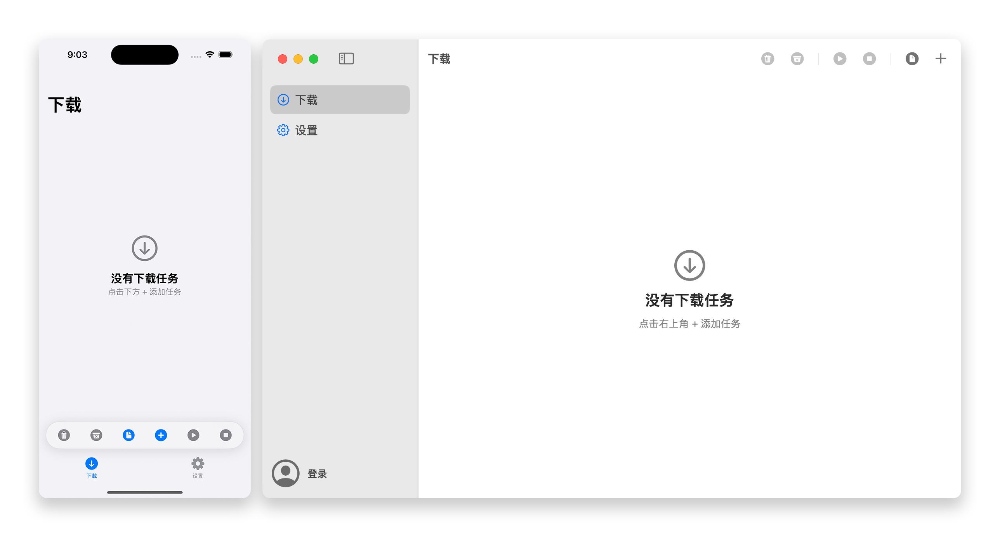

#

<h1 align="center">BiliDown</h1>
<h3 align="center">适用于 iOS/macOS 的B站视频下载工具，使用原生 Swift 开发 

## 预览

## 功能

| 平台 | 系统要求 |
| --- | --- |
| iOS | iOS 17.0 或更高 |
| macOS | macOS 13.0 或更高 |

支持解析视频链接、BV/av编号、用户主页或合集链接，还可以批量粘贴多个链接或编号，以及从多P投稿中选择下载分P视频。

- **多种下载模式**：支持音视频合并、单独下载视频或音频，以及下载封面。
- **多种格式支持**：视频支持 H.264 和 H.265，音频支持 MP3、M4A 和 WAV。
- **多种保存方式**：iOS 可保存到相册或「文件」，macOS 可选择保存目录。
- **支持登录使用**：登录后可以下载原画质高清视频，还能查看自己的收藏夹和订阅的合集并从中批量下载。

## 隐私

登录页面使用 `WKWebView` 加载 B 站的登录页。账号密码由 B 站页面处理，App 不直接获取密码，只读取登录后的 Cookie。

Cookie 保存在系统钥匙串中，不写入 `UserDefaults` 或普通文件。除用于访问 B 站接口外，不会发送到其他地方。

退出登录时会删除保存的 Cookie。App 不包含任何遥测功能。

## 致谢

- [SwiftLAME](https://github.com/hidden-spectrum/SwiftLAME) @hidden-spectrum - 用于编码MP3音频
